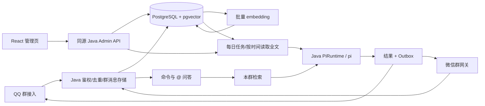

# 02 MVP 技术架构与工程

## 1. 最小技术栈

| 部分 | 选型 | 范围 |
| --- | --- | --- |
| 后端 | Java 21 + Spring Boot 当前受支持稳定版 + Maven Wrapper | 单个 Maven 应用，按包分层，不拆微服务 |
| pi | 固定 Node.js 和官方 pi CLI，Java JSONL RPC | 生成、问答、摘要均走 pi；不另写 TS 服务 |
| 前端 | React + TypeScript + Vite | 使用一个现成组件库；构建静态文件由 Spring Boot 提供 |
| 存储 | PostgreSQL 17 + pgvector + Flyway | 消息、向量、任务共库；不引入 Redis/MQ/独立向量服务 |
| 数据访问 | Spring JDBC，参数化 SQL | 简单事务、索引和持久任务，不引入复杂 ORM 抽象 |
| 定时与后台任务 | Spring `@Scheduled` 每 10 秒扫描持久化任务 | 单实例，有唯一键和执行状态，不上 Quartz 集群 |
| 认证 | Spring Security 会话认证 | 一个网页管理员，群命令另用稳定用户 ID 白名单 |
| 验证 | JUnit Jupiter、Testcontainers、HTTP/进程桩、少量浏览器用例 | 覆盖闭环和数据边界，不设机械覆盖率门槛 |

M0 固定版本与锁文件。生产凭据来自环境/挂载文件，网页只显示是否配置，不提供密钥编辑器。

## 2. 数据流



普通群消息只持久化并排队建索引，不逐条触发生成。embedding 可以由 Java 调用固定模型的向量接口；所有自然语言答案、分段摘要和日报合并都通过 pi。

## 3. 计划工程目录

```text
qqbot-pi/
  pom.xml / mvnw / mvnw.cmd
  src/main/java/.../
    channel/qq/              # M0 选定的一种 QQ 接入
    channel/weixin/          # M0 选定的一种微信群网关
    message/                 # 采集、命令、会话、Outbox
    pi/                      # 进程、协议、恢复
    memory/                  # 分块、embedding、群级检索
    schedule/                # 每日配置、扫描、日报运行
    admin/                   # 认证、群/记忆/任务 API
    persistence/             # JDBC 与数据库实体
  src/main/resources/db/migration/
  src/test/
  admin-web/                 # React + TypeScript + Vite
  runtime/pi/                # package.json + 锁文件
  deploy/                    # Dockerfile、Compose、环境模板
  plan/1107/
```

核心处理不依赖平台原始 DTO；适配器统一为内部消息。先用包约束职责，不创建多个仅含少量类的 Maven 模块。

## 4. 必要接口

| 接口 | 职责 |
| --- | --- |
| `GroupChannelAdapter` | 认证、接收归一化、发送群消息、报告连接与能力状态 |
| `PiRuntime` | 执行一次受控 prompt、消费事件、取消、返回最终文本 |
| `GroupMemoryService` | 索引、按强制群范围检索、来源解析、清除记忆 |
| `DailySummaryService` | 按时间窗读取全文、分批总结、保存报告 |
| `ScheduleService` | 保存 HH:mm、计算到期任务、去重创建运行 |

`GroupScope=(channel, botAccountId, groupId)` 必须由受信任入口生成。群消息不能通过 prompt 覆盖作用域；管理 API 必须先认证。定时任务的 scope 来自数据库配置。

## 5. 有界执行

- 单实例最多 2 个 pi 子进程；最多 1 个后台摘要步骤并发，保留即时问答运行能力。
- 同一用户临时会话一次一个生成；全局即时任务待处理上限 20，每会话上限 5。
- 收件持久化不因生成队列满而关闭；超限只拒绝自动问答，已采集群文本仍可进入记忆和日报。
- embedding 单 worker，默认每 30 秒或积累 50 条文本处理一批；索引失败可恢复。
- 日报为低优先级任务，步骤之间让出运行槽位；不与用户临时会话共用上下文。
- MVP 不实现多节点 lease 选主。数据库唯一键、状态 CAS、单实例启动互斥已经足够。

## 6. 验收

AC-BASE-01 验证后端构建、前端构建和配置；AC-PI-01 验证真实内核；AC-OPS-01 验证单实例部署；模块功能在各专题文档中定义，不为架构本身增加与用户闭环无关的门槛。
